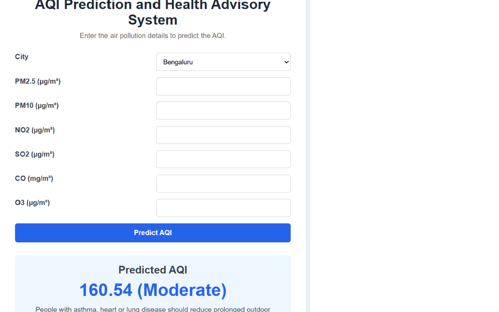

# AQI Prediction and Health Advisory System using XGBoost

## Project Overview

AQI Prediction and Health Advisory System using XGBoost is a machine learning based web application that predicts the Air Quality Index (AQI) from major air pollutant values.

The system preprocesses air quality data, trains an XGBoost regression model, and serves AQI predictions with health recommendations through a Flask web application.

## Objectives

- Predict Air Quality Index (AQI) from pollutant parameters using machine learning.
- Process and prepare air quality data for prediction.
- Support AQI prediction for multiple cities.
- Provide health recommendations based on the predicted AQI.
- Develop a simple and user-friendly web interface.

## Features

- AQI prediction for 24 Indian cities
- PM2.5, PM10, NO2, SO2, CO and O3 inputs
- Data cleaning and preprocessing using Pandas
- City encoding and feature scaling using Scikit-learn
- XGBoost regression model with train/test evaluation
- Flask web application with instant predictions
- Health recommendations based on the Indian National AQI (CPCB) categories
- Saved model and preprocessing files

## Technologies Used

- **Language:** Python
- **ML and data:** Pandas, NumPy, Scikit-learn, XGBoost, Joblib
- **Web:** Flask, HTML, CSS
- **Tools:** Visual Studio Code, Git, GitHub

## Dataset

Air Quality Data in India (2015-2020) by Rohan Rao, Kaggle (`city_day.csv`).
16,010 daily records across 24 cities after removing rows with missing values.

## System Workflow

```text
Kaggle Air Quality Dataset
        |
        v
Data Cleaning (remove missing values)
        |
        v
City Encoding & Feature Scaling
        |
        v
XGBoost Model Training
        |
        v
Model Evaluation (20% test set)
        |
        v
Save Model, Scaler and Encoder
        |
        v
Flask Web Application
        |
        v
User Input -> AQI Prediction -> Health Recommendation
```

## Results

Evaluated on a 20% held-out test set:

| Metric | Value |
|--------|-------|
| R2 Score | 0.9336 |
| RMSE | 26.89 |
| MAE | 15.31 |

AQI categories follow the Indian National AQI (CPCB) scale.

## Screenshot



## Project Structure

```text
├── app.py              # Flask application
├── model.py            # Model training and evaluation
├── data/city_day.csv   # Dataset
├── templates/          # HTML templates
├── static/             # CSS and screenshot
├── xgb_model.pkl       # Trained model
├── scaler.pkl          # Feature scaler
├── city_encoder.pkl    # City encoder
└── requirements.txt
```

## How to Run

```bash
pip install -r requirements.txt
python app.py
```

Then open http://127.0.0.1:5000 in your browser.